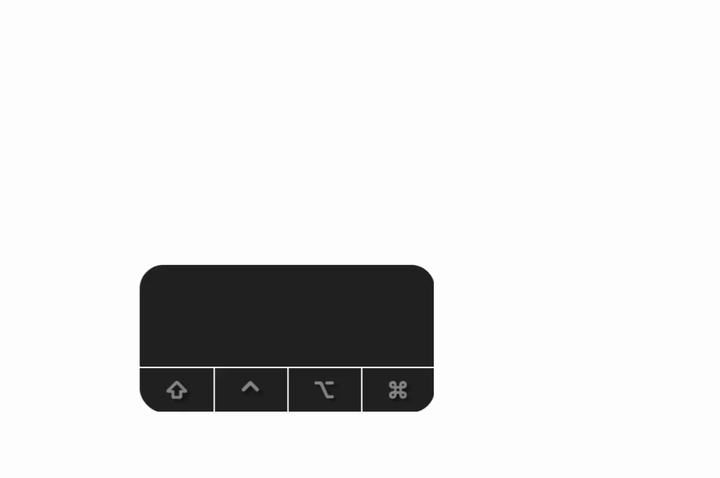
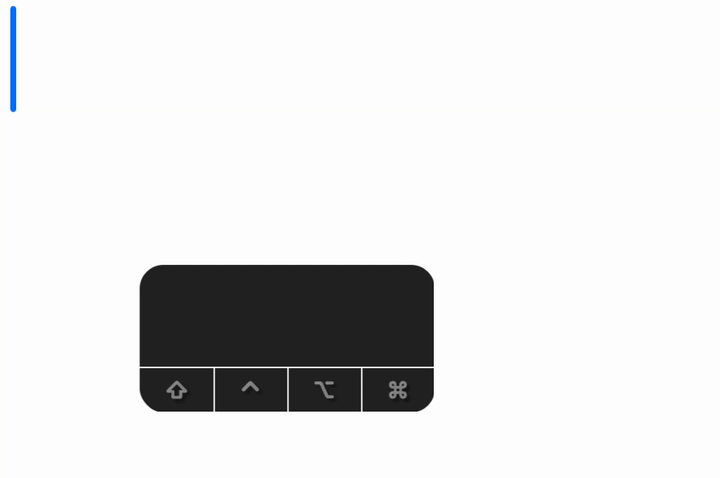

# 하늘키보드 (HaneulKeyboard)

<p align="center">
  <br>
  <a href="https://github.com/Hyunjin-Cho/HaneulKeyboard/releases"></a>
  <a href="https://github.com/Hyunjin-Cho/HaneulKeyboard/blob/main/LICENSE"></a>
  <a href="#요구사항"></a>
</p>

빠른 한↔영 전환과 한글 입력을 위한 macOS 메뉴바 앱 + 전용 입력기(IME)입니다. 사랑하는 딸 **하늘**이의 이름에서 따왔습니다.

> ⚠️ **베타버전이 끝났습니다. 이제 곧 정식버전이 출시됩니다. 조금만 기다려주세요.**
>
> 기준일: **2026-10-28**. 아래는 정식 출시를 준비 중인 현재 작업 트리의 기능 안내입니다. 기존 `2026.01`~`2026.07`은 베타 이력이며, 앱 설치 ZIP의 배포는 종료했습니다. GitHub의 **Source code** 파일은 설치 앱이 아닙니다. 정식 설치 파일은 준비가 끝나면 [배포 페이지](https://github.com/Hyunjin-Cho/HaneulKeyboard/releases)에 게시합니다.

## 어떤 앱인가요?

한글 모드인 줄 모르고 영어 단어를 입력했을 때, **Space나 문장부호로 단어를 끝내면** 영어로 바로잡습니다. `메ㅔㅣㄷ` → `apple`처럼 **자판을 잘못 선택해 생긴 입력**을 고치는 기능입니다.

| 하고 싶은 일 | 사용 방법 |
|---|---|
| 한글 ↔ 영어 전환 | Caps Lock 짧게 누르기 |
| 대문자 Caps Lock | Caps Lock 길게 누르기 |
| 영타 자동 변환 | 한글 모드에서 영어 단어를 입력한 뒤 Space 또는 문장부호 |
| 바뀐 단어 되돌리기 | **Shift+Space**. 다시 누르면 영어로 돌아갑니다. |
| 자동으로 바뀌지 않은 단어 직접 전환 | 확정된 커서 앞 단어에서 **Shift+Space** (`ㅡ5` ↔ `m5`, `ㅏ3` ↔ `k3`) |
| 등록된 발음을 영문으로 | **Shift+Space** (`레스토랑` → `restaurant`). 다시 누르면 원래 한글로 돌아갑니다. |
| 슬래시 뒤 바로 영어 입력 | 한글 모드에서 **/help** 입력. 일반 Space·슬래시 삭제·닫는 괄호 뒤 한글로 돌아옵니다. 설정에서 끌 수 있습니다. |
| 내 단어 추가·변환 금지 | 설정 → **개인 사전** |
| 안내 다시 보기 | 메뉴바 → **시작하기 다시 보기...** |

현재는 두벌식 한글·영어 입력을 지원합니다. 출시 준비 코드에는 **등록된 한글 발음 → 영문 표기** 변환도 포함되어 있으며, 설치본 검증은 [#84](https://github.com/Hyunjin-Cho/HaneulKeyboard/issues/84)에서 추적합니다.

## 데모

아래 영상은 영타 자동 변환의 동작 예시입니다. 현재 안내 화면과 아이콘은 새 디자인으로 바뀌었습니다.

<p align="center">
  <br><br>
  <br><br>
  
</p>

## 설치와 7단계 시작하기

**정식 설치 파일 게시 후** 다음 순서로 설치합니다.

1. 배포 페이지의 `HaneulKeyboard_<버전>.dmg`를 받아 더블클릭합니다.
2. 열린 설치 화면에서 `HaneulKeyboard.app`을 **Applications** 폴더로 드래그합니다. 복사가 끝나면 응용 프로그램(`/Applications`) 폴더의 앱을 실행하고 DMG를 꺼냅니다.
3. 메뉴바의 하늘키보드 아이콘 → **시작하기...**를 엽니다.
4. 1단계의 **하늘키보드 설치**를 누릅니다. 2단계에서 **입력 소스에 추가되어 있어요**가 보이면 **하늘키보드 선택**을 누릅니다. 추가가 필요한 상태라면 **키보드 설정 열기 → 텍스트 입력 → 편집 → + → 한국어 → 하늘키보드 (두벌식)**을 추가·선택합니다. macOS 버전에 따라 설정 화면의 배치는 다를 수 있습니다.
5. 3단계 자동 변환 → 4단계 되돌리기 → 5단계 등록 한글 단어 변환 → 6단계 슬래시 영어 입력을 각각 연습합니다. 7단계에서 메뉴바 사용법을 확인합니다.

기존 Apple ‘두벌식’은 필요에 따라 제거하고, 영어 입력용 **ABC는 남겨 주세요**. Caps Lock 전환은 macOS 기능을 사용하며 별도의 손쉬운 사용 권한을 요구하지 않습니다.

설치했는데 설정창 목록에 보이지 않으면 앱의 **키보드 설정 열기** 또는 **입력 소스 설정 열기**를 누릅니다. 출시 준비 코드(빌드72, [#92](https://github.com/Hyunjin-Cho/HaneulKeyboard/issues/92))는 macOS 26/27의 오래된 입력기 목록을 갱신합니다. 이미 열린 설정창의 재개방은 이 버튼을 누를 때만 수행하며 강제 종료하지 않습니다. 갱신을 마치지 못하면 별도 안내를 표시합니다.

안내 화면은 종이 질감, 단청 처마, 색동, 한복 인물로 구성했습니다. 오른쪽 인물은 **선택한 원본 3장의 정지 그림**입니다. 일곱 페이지에서 같은 크기와 위치를 유지하며, 원본의 신체 비율을 그대로 표시합니다. 3~6단계의 입력칸에서는 직접 연습할 수 있습니다. 설치·설정이 아직 끝나지 않았다면 마지막 화면에서 설치 단계로 돌아갈 수 있습니다.

**제거:** 메뉴바 → 설정 → **앱 관리 → 하늘키보드 전체 제거…**에서 앱·입력기·설정을 정리할 수 있습니다. 입력기 제거가 실패하거나 그 단계의 관리자 요청을 취소하면 개인 사전·설정을 보존합니다. 필수 정리가 실패하거나 확인되지 않으면 재시도용 앱을 남깁니다. Finder 자동 입력기 정리는 개인 사전·설정을 항상 보존합니다(2026-10-11 승인 B안). 앱만 휴지통으로 옮긴 경우의 입력기 정리 동작과 확인 방법은 [수동 검사 안내](docs/manual-test-checklist.md)를 참고하세요.

## 변환은 어떻게 동작하나요?

### 영타 자동 변환과 한국어 보호

영어 사전, 한국어 사전, 앞 단어의 문맥을 함께 확인합니다. 실제 한국어 단어, 초성체, 자모 이모티콘과 겹치는 입력은 보호합니다. 일부 짧은 단어는 검토된 영어 문맥에서만 바뀌며 모든 단어를 무조건 영어로 바꾸지는 않습니다.

- `how ㅁㄱㄷ you` → `how are you`처럼 영어 흐름을 이어 처리합니다.
- 직접 입력한 Space·문장부호에서 판정합니다. 클릭·앱 전환으로 입력을 확정할 때는 화면에 보이는 글자를 유지합니다.
- **설정 → 입력 기능 → 자동 변환**에서 전체 자동 변환을 끄거나 앱별로 끌 수 있습니다.
- **다른 입력기로 친 영어 문맥 사용**은 ABC 등에서 쓴 영어 문장의 커서 앞 문맥도 함께 확인합니다. 주변 글자는 저장하지 않습니다. **등록 단어를 붙여 쓴 영어 인식**은 사전에 있는 영어 단어 두 개의 정확한 조합만 확인하며, 각 단어는 네 글자 이상이어야 합니다. 두 기능은 기본 ON이며 설정에서 끄면 다음 단어부터 반영됩니다.
- 영어 철자를 추측해 고치지 않습니다. `aplle`처럼 사전에 없는 철자에 해당하는 한글 자판 입력은 자동 변환하지 않고 그대로 둡니다. 사용자가 직접 등록한 개인 사전과 직접 누르는 자판 변환은 별개입니다.
- 자동 변환이 틀렸다면 기본 **Shift+Space**로 되돌립니다. 설정에서 Option+Space / Control+Shift+Space / Option+Shift+Space로 바꿀 수 있습니다.
- ‘자판 변환’를 켜면 사전에 없는 단어도 자판 위치를 기준으로 직접 바꿀 수 있습니다. **직전 변환의 되돌리기가 우선**입니다. 등록 발음은 조합 중에도 바로 바뀌고, 그 밖의 조합 중인 글자는 먼저 확정합니다.

2026-10-28 개발 소스는 **영어+조사 분리**를 입력 중에도 미리 표시합니다. `github에`, `github밖에`, `github뿐`, `github라도`, `API는`과 등록 제품명 `T800에`, `a24에서`처럼 붙여 친 입력을 지원하며 Space·문장부호에서 확정합니다. 입력한 조사는 그대로 남기고 자동 교정하지 않습니다. `work`와 `재가`처럼 실제 한글과 겹치는 접두어는 보호하며, 필요한 영어는 개인 사전으로 지정할 수 있습니다. 앱별 입력 검증은 [#101](https://github.com/Hyunjin-Cho/HaneulKeyboard/issues/101)에서 추적합니다.

판정 순서·초기 조건의 현재 반영 상태·조사 목록과 범위는 [입력 변환 규칙 모음](docs/input-conversion-rules.md)에 모았습니다. 구현 근거: [EnglishDetector](IMESources/EnglishDetector.swift), [KoreanComposer](IMESources/KoreanComposer.swift), [수동 자판 변환](IMESources/ManualToggle.swift). 영어 사전 구성은 [manifest](dict_work/dict_manifest.tsv)에서 관리하고, 추가 단어는 실제 조합기로 한국어 충돌을 검사합니다.

### 등록 단어 변환

출시 준비 코드에 **검토한 한글 표기 4,554개 / 고유 영문 결과 4,339개**를 등록했습니다(2026-10-28 사전 기준: 기본 4,519개 + 숫자 별칭 35개). 이번에는 생활·가정·학교·업무·여행 등의 기본 명사 860개를 추가했습니다. `학교 → school`, `식당 → restaurant`, `주방 → kitchen`, `가게 → store`, `장갑 → gloves`, `견적서 → quotation`, `친구 → friend`처럼 정확히 등록한 표기를 **Shift+Space** 또는 설정한 변환 단축키로 바꿉니다. 기존 대응은 보존하고, 서로 다른 일상 뜻이 충돌하는 새 표기와 실제 인명·음악 그룹은 추가하지 않았습니다.

| 입력 | 단축키를 누른 결과 |
|---|---|
| 레스토랑 / 워크 / 라이트 | restaurant / work / light |
| 애플 / 삼성 / 엔비디아 | Apple / Samsung / NVIDIA |
| 아이폰 / 맥스튜디오 | iPhone / Mac Studio |
| 갤럭시24 / 아이폰17 | Galaxy24 / iPhone17 |
| 축구 / 미식축구 / 라이더 / 스포츠 | football / american football / rider / sports |
| 시각효과 / 색보정 / 폴리 | VFX / color grading / foley |
| 아메리카노 / 베이글 / 기내수하물 | americano / bagel / carry-on baggage |
| 로그라이크 / 셰이더 / 파인튜닝 | roguelike / shader / fine-tuning |
| 애니메이션 / 스톱모션 / 영화 / 디스코드 | animation / stop-motion / movie / Discord |
| 선물 / 선물거래 / 주식 | gift / futures trading / stock |
| 단어 / 물 / 책상 / 세탁기 | word / water / desk / washing machine |
| 학교 / 식당 / 주방 / 가게 | school / restaurant / kitchen / store |
| 장갑 / 견적서 / 친구 / 가족 | gloves / quotation / friend / family |
| 저장용량 / 메모리용량 | storage capacity / memory capacity |

발음 표기뿐 아니라 `축구 → football` 같은 지정 대응도 정확히 등록한 단어만 지원합니다. 일반 번역이나 문맥 추론은 하지 않습니다. 아트·영상·사운드, 생활·음식·여행, 컴퓨터·AI·게임, 스포츠·브랜드·금융 등의 [범주와 수량](docs/vocabulary-categories.md)를 별도로 관리합니다.

`선물`은 항상 `gift`로 바꿉니다. 금융 의미는 `선물거래`·`선물계약`처럼 구분해 등록합니다. 인명·음악 그룹명은 이 한글→영문 대응 사전에서 제외했습니다.

다시 누르면 **실제로 입력했던 한글**로 돌아옵니다. 일반 Space에서는 발음 변환하지 않습니다. `겔럭시`, `에플`, `레스토랑에서`처럼 사전에 없는 표기는 추측하지 않으며, 자판 변환이 켜져 있으면 기존 자판 배열 변환을 따릅니다. 설정 → 입력 기능 → 단축키 변환에서 **등록 단어 변환**를 끌 수 있습니다. 자동 변환 끄기·개인 사전의 자동 변환 금지와는 별개의 명시적 조작입니다.

숫자 이름은 갤럭시 S·아이폰의 확인된 세대 번호와 다음 3개 번호만 명시적으로 등록합니다. **미발표 번호는 입력 편의를 위한 예약 표기이며 출시 정보가 아닙니다.** 모든 제품·파생형·용량 조합을 만들지 않습니다. 범위, 원본 사전, 검증 및 설치 후 확인할 항목은 [발음 변환 명세](docs/phonetic-conversion.md)를 참고하세요.

### 숫자 이름·단위·아트 용어

현재 출시 준비 코드에는 다음 지원이 포함되어 있습니다. 실제 앱 설치 후 확인할 항목은 [출시 후보 기록](docs/releases/2026.9-test.md)에 남깁니다.

| 종류 | 예시와 범위 |
|---|---|
| 숫자가 섞인 이름 | `T800`, `800T`, `a24`, `a16z`, `a7r` 등 **단어 전체가 등록된 이름**. 입력한 대소문자를 유지합니다. |
| 단위 | `oz`, `km`, `kg`, `12mp`, `100ml`, `35mm`, `1.25 kg` 등. 짧은 단위 중 일부는 숫자와 함께 썼을 때만 변환합니다. |
| 아트·디자인 | `risograph`, `ransomizer`, `surrealism` 등 미술·인쇄·타이포그래피·영상 분야의 검토된 단어. |

단위의 값을 환산하거나 표기 대소문자를 교정하는 기능은 아닙니다. `ml` 단독처럼 한글과 겹치는 입력은 보호하며, `km/h`·`m/s²` 같은 복합 표기 전체를 지원하는 것은 아닙니다. 자세한 범위와 검증 결과는 [단위 지원](docs/measurement-units.md), [아트·디자인 용어](docs/art-design-vocabulary.md)를 참고하세요.

### 개인 사전

**설정 → 개인 사전**에서 세 목록을 관리합니다. 저장하면 다음 단어부터 반영됩니다.

- **변환 추가:** 기본 사전에 없는 영어 단어·제품명을 등록합니다. 숫자가 섞인 이름도 지원하며 실제로 한 단어로 처리할 수 있는 형태만 받습니다.
- **변환 금지:** 영어 표기나 한글 모드 표기를 등록합니다. 같은 항목이 변환 추가에도 있으면 **금지가 우선**합니다. 직접 누르는 수동 한영 전환은 별개입니다.
- **최근 되돌린 변환:** 되돌린 한글·영어 쌍을 최근 50개까지 보관하고, 금지하거나 단어 제안으로 연결합니다.

개인 사전은 이 Mac의 설정에 저장됩니다. 한글 발음과 영어를 자유롭게 짝짓는 번역 사전은 아닙니다.

## 설정과 업데이트

설정은 **입력 기능 / 개인 사전 / 버전·업데이트 / 앱 관리**의 네 왼쪽 메뉴입니다(#88). 입력 기능은 **자동 변환 / 단축키 변환** 두 페이지로 나눴습니다. 자동 변환에는 영타 자동 변환·다른 입력기의 영어 문맥·등록 단어 조합 인식·앱별 예외, 단축키 변환에는 변환 단축키·자판 변환·등록 단어 변환·되돌리기·슬래시 영어 입력이 있습니다. 개인 사전에는 단어 관리, 버전·업데이트에는 최신 버전과 설치된 버전 순서의 표시 및 업데이트, 앱 관리에는 설치 상태·입력기 설치·제거와 하늘키보드 전체 제거가 있습니다. 앱 관리 아래의 별도 **응원하기** 버튼은 기존 후원 안내창을 엽니다. 800×660 창에 불투명 종이 배경·처마·손글씨 제목·리소그래프 매듭과 단청을 사용하며, 긴 내용은 스크롤해서 읽습니다.

슬래시 영어 입력은 기본 ON이며 **입력 기능 → 단축키 변환**에서 끌 수 있습니다(#87). `/`는 그대로 남고 뒤의 영어가 바로 입력되며, 일반 Space·시작 슬래시 삭제·닫는 괄호 `) ] }` 뒤에는 한글 조합을 재개합니다. 입력 대상·입력 소스가 바뀌거나 앱이 입력 세션을 종료하면 안전하게 초기화합니다. 앱 자체의 상단 전환 팝업과 관련 설정은 제거했습니다(2026-10-18). macOS 커서 옆 Caps Lock 표시의 빈 글리프 문제는 아직 조사 중입니다(#81).

**설정 → 버전·업데이트**에서 설치된 버전과 마지막으로 확인한 최신 공개 버전을 따로 볼 수 있습니다. 확인한 번호가 없으면 **확인 전**으로 표시하며, 상태 왼쪽과 **지금 확인** 버튼 오른쪽을 한 줄에 배치합니다. 설치 번호가 공개 번호보다 앞서는 검토 빌드는 그 상태를 따로 알려줍니다.

- **자동 확인**은 기본으로 켜져 있습니다. 앱 실행 약 15초 뒤와 이후 매시간 확인 시점이 되었는지 살피고, 마지막 성공 확인에서 **24시간**이 지났을 때 GitHub에 조회합니다.
- 새 버전과 설치 파일을 발견하면 **현재 버전 → 새 버전** 안내창을 띄웁니다. 같은 버전은 재실행 후에도 자동으로 반복해서 알리지 않습니다.
- **지금 확인**은 새 버전 알림을 꺼도 사용할 수 있습니다. 결과는 같은 설정 화면에 표시하며 별도 알림창을 띄우지 않습니다.
- **설치는 사용자가 새 버전 설치를 눌렀을 때만** 시작합니다. 번들 ID, 서명 Team, 코드 서명, Apple 공증, 버전 상승을 검사합니다. 검증에 실패하면 기존 앱을 유지합니다.
- 사용자가 선택하는 새 버전 설치는 `/Applications`에 있는 앱을 대상으로 합니다. 사용자 폴더에 설치한 IME도 함께 갱신하며, 시스템 폴더(`/Library/Input Methods`)에 설치한 경우 별도 갱신 안내가 나타날 수 있습니다.

2026-10-24: 설정의 「버전·업데이트」에서 **새 버전 알림**을 켜고 끕니다. **지금 확인**의 결과는 같은 화면에 표시하며 별도 알림창을 겹쳐 띄우지 않습니다. 설정에서 확인한 버전은 이후 자동 알림도 반복하지 않습니다. 자동 알림의 **버전·업데이트 열기**와 메뉴바의 새 버전 항목은 같은 설정 화면으로 연결됩니다.

GitHub의 새 버전을 알아내려면 주기적인 조회가 필요합니다. 서버에서 즉시 보내는 푸시 알림 방식은 아니며, 사용자가 주기를 고르는 설정은 없습니다. 구현과 검증 근거는 [Updater](Sources/Updater.swift), [UpdateDecision](Sources/UpdateDecisions.swift), [배포 체크리스트](docs/release-checklist.md)에 있습니다.

## 개인정보와 후원

**키 입력·개인 사전을 AI 서비스로 보내지 않습니다.** 한글을 조합하는 입력기에는 네트워크 코드가 없고, 메뉴바 앱은 업데이트 확인·다운로드에 GitHub를 사용합니다. 입력 내용의 서버 저장·분석·학습 기능은 없습니다. 직접 등록한 개인 사전과 최근 되돌린 변환은 기기에 저장합니다.

단어 제안은 **설정 → 개인 사전 → 단어 제안하기...**에서 GitHub 작성 화면을 열어 사용자가 제출하는 방식입니다. 제안 화면을 여는 과정에서 사용자가 작성한 제안이 URL에 포함됩니다. 자세한 저장·전송 범위와 비밀번호 입력의 한계는 [개인정보 안내](PRIVACY.md)에 설명되어 있습니다.

**하늘키보드는 무료입니다.** 메뉴바나 설정의 **하늘키보드 응원하기**에서 후원 안내를 볼 수 있습니다. 현재 후원 연결은 준비 중이며, 후원 여부가 입력 기능을 제한하지 않습니다.

## 요구사항과 알려진 한계

- 빌드의 최소 대상은 **macOS Sonoma 14.0**이며, 배포 대상은 **Apple Silicon + Intel Universal**입니다. Mac 자체가 해당 macOS를 지원해야 합니다.
- 현재 **두벌식**만 지원합니다.
- 일부 앱·사이트의 입력 처리 방식에 따라 동작이 다를 수 있습니다.
- **Terminal·Ghostty 등에서는 커서 앞 글자의 교체가 지원되지 않아 되돌리기·수동 전환을 사용할 수 없습니다.** 영타 자동 변환은 별개로 동작하며, 원치 않으면 앱별로 끌 수 있습니다.
- 웹 비밀번호 칸 등에서 앱이 보안 입력을 올바르게 활성화하지 않으면 한글 조합이 가능할 수 있습니다. 민감한 입력은 **ABC 영어 모드**를 사용하세요.
- 후보 창의 글자가 연하게 표시되는 현상이 있습니다. 지원 OS·앱 조합별 실제 사용 검증은 계속 진행 중입니다.

## 버전 체계

**정식 버전부터 `YYYY.MM.DD` — 연도.월.일**을 사용합니다. 예를 들어 **2026년 10월 10일에 실제 배포하면 `2026.10.10`**입니다. 이 날짜는 예시이며 출시일 공지가 아닙니다.

- `2026.01`~`2026.07`은 과거 순번형 **베타** 번호입니다. 당시 두 번째 칸은 월이 아니었습니다. 배포 글 제목에 `-beta`를 표시합니다.
- 공개 버전은 날짜 + 접미어입니다. 기본판은 `2026.10.15`, 핫픽스는 `2026.10.15_hotfix`처럼 씁니다. **하루 기본판 1개와 같은 날 핫픽스 1개까지** 배포합니다. Git 태그·앱 화면·DMG/ZIP 이름은 이 공개 버전을 따릅니다. Apple 내부 버전은 숫자 날짜로 유지하고 `HANEUL_RELEASE_SUFFIX`로 핫픽스를 구분합니다. 별도의 빌드 번호도 올립니다.
- 이전 순번형 설치본과 비교할 수 있도록 앱은 숫자 2~3칸을 읽습니다. `2026.9`보다 `2026.10.10`이 최신입니다.
- **같은 날짜·같은 버전으로 파일만 교체하지 않습니다.** 현재 업데이트는 버전과 빌드 번호가 모두 올라야 인식합니다. 같은 날짜의 두 번째 기본판이나 두 번째 핫픽스는 배포하지 않습니다.

## 개발과 저장소 구조

```text
Sources/                  메뉴바·설정·7단계 안내·설치·업데이트
IMESources/               두벌식 조합·영타 판정·수동 전환·개인 사전
Resources/IM/             입력기 사전과 입력 소스 아이콘
Resources/Brand/          앱·메뉴바 아이콘 원본
Resources/Onboarding/     안내 그림·종이 질감·글꼴 및 라이선스
Tests/                    코어·업데이트·안내 입력 검사
Tools/ + scripts/         사전 검역·테스트·빌드·공증 도구
dict_work/                사전 manifest·출처·검역 결과
docs/                     기능 범위·디자인·배포/수동 검사 기록
project.yml               XcodeGen 프로젝트 정의와 버전·빌드 번호
```

메인 앱 `HaneulKeyboard.app`은 `Contents/Helpers/HaneulKeyboardIM.app`을 포함합니다. 설치 안내가 입력기를 `~/Library/Input Methods/`에 설치합니다. 메뉴바는 AppKit `NSStatusItem`·`NSMenu`, 설정과 안내는 SwiftUI, 입력기는 IMKit을 사용합니다.

```bash
brew install xcodegen
xcodegen generate
xcodebuild -scheme HaneulKeyboard -configuration Debug build

# 입력기 코어 / 업데이트 / 안내 입력 검사
bash scripts/run_ime_tests.sh
bash scripts/run_updater_tests.sh
bash scripts/run_slash_tests.sh
python3 scripts/test_postinstall_probe.py
python3 scripts/test_uninstall.py
bash scripts/run_onboarding_tests.sh

# 사전 검역
bash scripts/audit_wordlist.sh --smoke
bash scripts/audit_units.sh
```

서명·공증 배포 파일은 **메인 앱 타겟**으로 만듭니다. Developer ID 인증서와 `haneul-notary` 키체인 프로필이 필요합니다.

```bash
python3 -m venv .tools/dmg
.tools/dmg/bin/python -m pip install -r scripts/requirements-dmg.txt
PACKAGE_ONLY=1 bash scripts/build_notarize_install.sh HaneulKeyboard
```

결과물은 저장소 루트의 `HaneulKeyboard_<공개 버전>.dmg`(첫 설치), `.zip`(앱 안에서 사용자가 선택하는 업데이트)과 각각의 SHA-256 파일입니다. 앱과 DMG를 각각 서명·공증·검증한 뒤 내놓으며 기존 같은 이름 파일을 덮어쓰지 않습니다. `PACKAGE_ONLY=1`은 설치까지 진행하지 않습니다(`ZIP_ONLY=1`도 같은 동작의 호환 이름). 게시 전 [배포 체크리스트](docs/release-checklist.md)와 [실제 앱 검사 항목](docs/manual-test-checklist.md)을 확인하세요.

2026-10-28: 공증을 진행하지 않는 로컬 검증은 같은 공식 스크립트의 다음 옵션을 사용합니다. Developer ID Release Universal 앱과 내장 입력기를 빌드하고 서명·고지 포함을 확인합니다. 공증 프로필 조회·업로드·DMG/ZIP 생성·설치는 실행하지 않으며 다른 패키징 옵션과 함께 쓸 수 없습니다. 결과는 `.build/DerivedData-Local/Build/Products/Release/HaneulKeyboard.app`입니다.

```bash
LOCAL_BUILD_ONLY=1 bash scripts/build_notarize_install.sh HaneulKeyboard
```

새 버전 안내창은 기존 버전·업데이트 설정으로 연결됩니다. 메뉴바의 **새 버전 확인…**은 알림 OFF 상태에서도 직접 조회하고 같은 설정 화면에 결과를 표시합니다. 다운로드와 설치는 **새 버전 설치**를 눌러야 시작합니다.

최신 후보와 남은 검증은 [통합 검증 #86](https://github.com/Hyunjin-Cho/HaneulKeyboard/issues/86), [실제 앱 검사 항목](docs/manual-test-checklist.md), [배포 체크리스트](docs/release-checklist.md)에서 확인합니다. **2026-10-28 현재 공증·공개 배포는 보류 중이며, 로컬 Developer ID 검증본과 정식 공증 설치 파일을 구분합니다.** 로컬 검토 ZIP·GIF·화면 검사는 설치용 배포본이나 실제 OS 입력 검증을 뜻하지 않습니다. 과거 [빌드69 피드백 기록](docs/releases/2026.9-build69-feedback.md)과 [DMG 시안·검증](docs/design/dmg-installer-2026-10-10.md)은 당시 근거로 보존합니다.

작업은 [GitHub Issues](https://github.com/Hyunjin-Cho/HaneulKeyboard/issues)에서 기능·완성된 작업 묶음 단위로 관리합니다. 코드·테스트 후보가 준비되어도 실제 제품 적용과 필요한 설치본 검증이 남았다면 티켓은 열어 둡니다.

## 라이선스와 감사의 글

앱 코드는 **Apache License 2.0**입니다. [LICENSE](LICENSE)와 원본 이름·주소가 담긴 [NOTICE](NOTICE)를 확인하세요. 수정·재배포·상업적 사용은 해당 라이선스 조건을 따릅니다. 배포물에는 LICENSE와 관련 NOTICE 고지를 유지하고 변경한 파일에는 수정 사실을 표시해야 합니다.

기존 MIT 배포본에 부여한 권리는 그대로 유지됩니다. 과거 고지는 [보존한 MIT 원문](LICENSES/HaneulKeyboard-MIT-legacy.txt)에 있습니다. 사전과 글꼴에는 별도 라이선스가 적용됩니다.

| 자료 | 라이선스 |
|---|---|
| 국립국어원 우리말샘 한국어 목록 | CC BY-SA 2.0 KR |
| NGSL 영어 목록 | CC BY-SA 4.0 |
| SCOWL/ESDB 영어 목록 | MIT-like |
| US Census·SSA 인명 데이터 | Public Domain |
| GeoNames 지명 | CC BY 4.0 |
| Wikidata 축구 클럽·선수 | CC0 1.0 |
| 고운바탕·나눔손글씨 펜 | SIL Open Font License 1.1 |

[McBopomofo](https://github.com/openvanilla/McBopomofo)의 입력기 등록·설치 구조, 공개 사전과 글꼴, 오픈소스 기여자들에게 감사합니다. **[Claude](https://claude.com/claude-code)(Anthropic)**와 **[Codex · ChatGPT](https://openai.com/codex/)(OpenAI)**도 설계·개발·검증·문서·시각 디자인 과정에 함께했습니다. 개발 도구를 사용했다는 뜻이며, 앱이 입력 내용을 AI에 전송한다는 뜻은 아닙니다.

출처·가공 방식·원문 라이선스는 [감사의 글](ACKNOWLEDGEMENTS.md)에 모았습니다. 버그나 단어 제안은 [Issues](https://github.com/Hyunjin-Cho/HaneulKeyboard/issues)로 알려 주세요.

---

# English

HaneulKeyboard is a macOS menu bar app and two-set Korean input method, named after my daughter Haneul — “sky” in Korean.

**Beta distribution has ended; the first stable version is being prepared.** Updated 2026-10-28. This README describes the current development tree, including features awaiting installed-app verification. Old releases `2026.01`–`2026.07` are beta history; their app ZIPs are no longer offered. GitHub’s “Source code” archives are not installable apps.

## Features and installation

- **Caps Lock:** short press to switch Korean/English, long press for uppercase mode, using macOS input-source switching.
- **Wrong-layout correction:** type English while in Korean mode, then press Space or punctuation: `메ㅔㅣㄷ` → `apple`. Korean words and jamo expressions are protected, with reviewed context-dependent exceptions.
- **Shift+Space:** exact registered Hangul spellings map to English with the configured shortcut (Shift+Space by default), and a second press restores the original text. The 2026-10-28 dictionary contains 4,554 Hangul spellings and 4,339 distinct English outputs, including 860 new basic nouns. Examples: `학교` → `school`, `식당` → `restaurant`, `주방` → `kitchen`, `장갑` → `gloves`. Existing mappings and owner-designated meanings are preserved. Common relationship and occupation nouns are included; proper person names and music groups remain excluded. Newly considered ambiguous everyday meanings are deferred. Plain Space does not perform semantic conversion.
- **Personal dictionary:** add conversion words, block unwanted conversions, and review the last 50 reverted pairs. Stored locally.
- **Expanded vocabulary:** registered alphanumeric names (`a7r`, `800T`), units (`12mp`, `100ml`, `35mm`), and reviewed art/design terms (`risograph`, `ransomizer`, `surrealism`). Unit conversion is not a measurement calculator. English with an attached Korean particle is previewed while composing, including `github밖에`, `github뿐`, `github라도`, and registered alphanumeric names such as `T800에` and `a24에서`. The typed particle and original-text round trip are preserved; particles are not automatically corrected.
- **Seven-step onboarding:** install, select the input source, practice wrong-layout correction, practice reverting, convert registered Hangul words, try slash English input, and find the menu bar. Paper texture, Korean architectural motifs, and the three selected original characters connect the guide to the new icon. The figures stay at the same size and position across all seven pages, preserving their original body proportions without limb deformation or page-specific scaling.
- **Slash English input:** enabled by default; type `/help` in Korean mode to enter English immediately, keeping the slash. Ordinary Space, deleting the starting slash, or a closing delimiter `) ] }` resumes Korean composition. The setting is independent of automatic conversion and per-app exclusions.
- **Conservative English context:** optionally recognize cursor-adjacent English written with another input source and exact combinations of two dictionary words, each at least four letters long. Both options are enabled by default and can be disabled for the next word. Nearby text is not stored. Unregistered misspellings such as `aplle` are left as typed rather than guessed or converted.
- **Updates:** optional periodic GitHub checks; a notice shows current/new versions once per new version. Installation requires a click and passes signature, notarization, identity, and version checks.

After the stable package is published, download `HaneulKeyboard_<version>.dmg` from [Releases](https://github.com/Hyunjin-Cho/HaneulKeyboard/releases), open the DMG, drag the app into Applications, launch the copied app, and follow **시작하기...**. Keep ABC for English and add **하늘키보드 (두벌식)** in macOS Keyboard settings. Reopen the guide with **시작하기 다시 보기...**.

Settings has four sidebar sections: Input Features, Personal Dictionary, Version & Updates, and App Management. Input Features contains Automatic Conversion and Shortcut Conversion pages. Automatic Conversion includes English context, exact dictionary compounds, and per-app exclusions. Shortcut Conversion includes the conversion key, layout/registered-word conversion, reverting, slash input, and input-source guidance. The optional blue guidance panel shows white “하늘” text for about 0.9 seconds when switching to Haneul while the main app is running; it is separate from the macOS caret HUD. A separate Support button below App Management opens the donation information. Version & Updates shows the running installed app version and the last checked public release separately. The window is 800×660 with the existing opaque paper design and original risograph ornaments. Removal is under **앱 관리 → 하늘키보드 전체 제거…**. Failed or cancelled input-method removal preserves personal settings and the dictionary; Finder-triggered cleanup always preserves them. Donations are optional; the donation destination is still being prepared.

As of 2026-10-28, notarization and public distribution remain paused at the owner's request. Local Developer ID test builds are separate from notarized release installers. Local review archives and offscreen captures do not replace notarized installers or real IMK/host-app validation.

The build targets macOS 14+ with Universal Apple Silicon/Intel binaries. Host-app support varies; reverting/replacing committed text does not work in Terminal/Ghostty. Phonetic conversion is integrated into the development build; installed IMK/host-app verification remains tracked in [#84](https://github.com/Hyunjin-Cho/HaneulKeyboard/issues/84). It accepts curated exact spellings, not guessed misspellings. Numeric aliases include six explicitly reserved future numbers; these do not announce product releases. See the [specification](docs/phonetic-conversion.md).

## Privacy, versions, and credits

The IME contains no networking code. The menu bar app contacts GitHub for update checks/downloads; typing and personal dictionaries are not uploaded to AI services. See [Privacy](PRIVACY.md) for local storage, suggestion URLs, and secure-input limitations.

Stable versions use **`YYYY.MM.DD`**, the actual publication date. `2026.10.10` is an example for an October 10 release, not an announced date. Legacy `2026.01`–`2026.07` beta numbers used a sequence, not months. The app still compares legacy numeric versions. Public tags, displayed app versions, and DMG/ZIP names must match. Each date allows one base release and at most one hotfix. Hotfixes append `_hotfix` (for example, `2026.10.15_hotfix`); the Apple bundle version remains numeric and the signed `HaneulReleaseSuffix` identifies the hotfix. The build number must also increase. Replacing an asset under the same version does not deliver another update.

App code: **Apache License 2.0**, with [LICENSE](LICENSE) and [NOTICE](NOTICE) bundled in both the main app and the IME. Prior MIT distributions retain their original terms; the [legacy notice](LICENSES/HaneulKeyboard-MIT-legacy.txt) is preserved. Bundled dictionaries/fonts retain their own licenses: Urimalsaem (CC BY-SA 2.0 KR), NGSL (CC BY-SA 4.0), SCOWL/ESDB (MIT-like), US Census/SSA (public domain), GeoNames (CC BY 4.0), Wikidata (CC0), Gowun Batang/Nanum Pen Script (OFL 1.1). See [Acknowledgements](ACKNOWLEDGEMENTS.md) for sources and notices.

Thanks to [McBopomofo](https://github.com/openvanilla/McBopomofo), the open-source community, **[Claude](https://claude.com/claude-code) (Anthropic)**, and **[Codex · ChatGPT](https://openai.com/codex/) (OpenAI)** for helping with development and design. Report problems or suggestions in [Issues](https://github.com/Hyunjin-Cho/HaneulKeyboard/issues).
